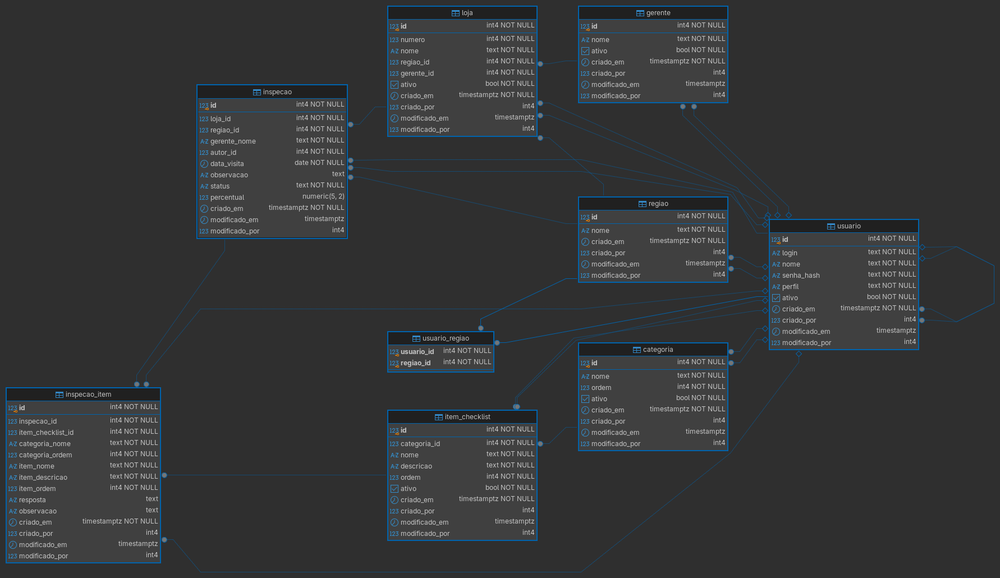

# Passo Certo - Checklist Inspeção

Aplicação Web para os supervisores regionais da rede **Passo Certo** registrarem inspeções de padrão de qualidade das lojas.

Desenvolvido como prova técnica para Desenvolvedor(a) .NET Júnior da empresa 
[SystemFy ](https://www.linkedin.com/company/systemfy/home/)

**Stack:** 
- .NET 8 
- ASP.NET Core Razor Pages
- PostgreSQL 16
- Npgsql + Dapper (SQL escrito à mão, sem ORM)
- Bootstrap 5

---

## Sumário

- [Pré-requisitos](#pré-requisitos)
- [Como executar](#como-executar)
- [Usuários de teste](#usuários-de-teste)
- [Funcionalidades](#funcionalidades)
- [Modelagem do banco](#modelagem-do-banco)
- [Decisões técnicas](#decisões-técnicas)
- [Premissas adotadas](#premissas-adotadas)
- [Bônus implementados](#bônus-implementados)
- [Melhorias que faria](#melhorias-que-faria)
- [Estrutura do projeto](#estrutura-do-projeto)

---

## Pré-requisitos

| Ferramenta              | Versão          |
| ----------------------- | --------------- |
| .NET SDK                | 8.0 ou superior |
| PostgreSQL              | 14 ou superior  |
| Docker + Docker Compose | opcional        |

---

## Como executar

### 1. Clonar o repositório

```bash
git clone https://github.com/JoaoPedroPitarelo/checklist-inspecao
cd checklist-inspecao
```

### 2. Criar o banco

Os scripts ficam em [`database/`](database/) e devem rodar **nesta ordem**:

| Script                  | Conteúdo                                                                                   |
| ----------------------- | ------------------------------------------------------------------------------------------ |
| `01_schema.sql`            | Criação das tabelas e restrições                                                           |
| `02_seed.sql`              | Dados iniciais: regiões, lojas, gerentes, usuários e itens do checklist                    |
| `03_dashboard_records.sql` | 28 inspeções de exemplo (opcional, mas recomendado para avaliar o histórico e o dashboard) |

#### Opção A: com Docker / Podman (recomendado)

Na raiz do projeto:
```bash
# Podman
podman compose up -d

# Docker
docker compose up -d

```
O container sobe o PostgreSQL 16 e executa os três scripts automaticamente na primeira inicialização.

> **Sobre o Podman:** o projeto foi desenvolvido com o [Podman](https://podman.io/), uma alternativa
> ao Docker que roda os containers sem um daemon e sem exigir privilégios de root (rootless), mais integrado a ambientes Linux.
>
> A linha de comando e o formato do `docker-compose.yml` são compatíveis, então o mesmo arquivo
> funciona nos dois. Com o Podman, o `compose` requer `podman-compose` instalado.

Para recriar o banco do zero (apaga todos os dados):

```bash
# Podman
podman compose down -v && podman compose up -d

# Docker
docker compose down -v && docker compose up -d
```

#### Opção B: PostgreSQL local

```bash
psql -U postgres -c "CREATE USER checklist WITH PASSWORD 'checklist';"
psql -U postgres -c "CREATE DATABASE checklist OWNER checklist;"

psql -U checklist -d checklist -h localhost -f database/schema.sql
psql -U checklist -d checklist -h localhost -f database/seed.sql
psql -U checklist -d checklist -h localhost -f database/dashboard_records.sql
```


### 3. Configurar a string de conexão

[`src/ChecklistInspecao.Web/appsettings.json`](src/ChecklistInspecao.Web/appsettings.json):

```json
"ConnectionStrings": {
  "Default": "Host=localhost;Port=5432;Database=checklist;Username=checklist;Password=checklist"
}
```

### 4. Executar a aplicação

```bash
cd src/ChecklistInspecao.Web
dotnet run
```

Acesse **http://localhost:5121** e entre com um dos usuários abaixo.

---

## Usuários de teste

Todos os usuário tem usam a senha **`Prova@123`**.

| Login          | Perfil        | Abrangência   |
| -------------- | ------------- | ------------- |
| `paulo.mendes` | Supervisor    | Litoral       |
| `renata.alves` | Supervisor    | Metropolitana |
| `diego.costa`  | Supervisor    | Interior      |
| `helena.prado` | Diretoria     | Todas         |
| `carla.nunes`  | Administrador | Todas         |
| `sergio.lima`  | Supervisor    | Interior      |

### Valores de referência

Logo após a carga dos três scripts, o dashboard de `helena.prado` com o período padrão (últimos 30 dias) mostra:

| Indicador | Valor |
|---|---|
| Inspeções | 10 (9 concluídas, 1 rascunho) |
| Percentual médio | 80,4% |
| Lojas inspecionadas | 8 de 11 |
| Itens | OK 106, Pendentes 26, N/A 3 |
| Não inspecionadas | 303 Outlet, 104 Orla, 202 Terminal |


---

## Funcionalidades

| Requisito                 | Onde                                                                                   |
| ------------------------- | -------------------------------------------------------------------------------------- |
| RF01 Autenticação         | `/Login`, botão Sair no menu                                                           |
| RF02 Perfis e abrangência | Aplicada em todas as consultas, no SQL                                                 |
| RF03 Criar inspeção       | Menu **Nova inspeção** (só Supervisor)                                                 |
| RF04 Preencher checklist  | Abre após criar; rascunhos podem ser retomados pelo detalhe acessado no histórico      |
| RF05 Concluir inspeção    | Botão **Concluir** ao fim do preenchimento                                             |
| RF06 Histórico            | Menu **Histórico** (lista paginada) → número da inspeção (detalhe)                     |
| RF07 Dashboard            | Página inicial                                                                         |
| RF08 Auditoria            | Colunas em todas as tabelas; exibida no detalhe da inspeção                            |
| RF09 Scripts de banco     | Pasta [`database/`](database/), arquivos: schema.sql, seed.sql e dashboard_records.sql |
| RF10 Responsividade       | Bootstrap; criar e preencher pensados para dispositivos móveis                         |

---

## Modelagem do banco



Diagramas de apoio: [diagrama de classes](docs/diagrama_classes.png) · [casos de uso](docs/diagrama_caso_de_uso.png)

| Tabela                        | Papel                                                               |
| ----------------------------- | ------------------------------------------------------------------- |
| `regiao`, `loja`, `gerente`   | Estrutura da rede                                                   |
| `usuario`, `usuario_regiao`   | Usuários e abrangência (N:N: um supervisor pode ter várias regiões) |
| `categoria`, `item_checklist` | Cadastro do checklist                                               |
| `inspecao`                    | Uma visita: loja, data, autor, status, percentual                   |
| `inspecao_item`               | A resposta de cada item em uma inspeção                             |

Pontos principais:

- **Snapshot do checklist (RN07).** Ao criar a inspeção, os itens ativos são **copiados** para `inspecao_item` (nome, descrição, categoria e ordem). Alterar, reordenar ou desativar itens depois não afeta inspeções existentes. O `item_checklist_id` é mantido para agrupar pendências no dashboard.
- **Snapshot de região e gerente (RN08).** `inspecao.regiao_id` e `inspecao.gerente_nome` são gravados a partir da loja na criação.
- **Respostas nulas = não respondidas (RN03).** `resposta` aceita nulo até o supervisor responder.
- **Percentual nulo = não calculável (RN01).** Guardado como `numeric(5,2)`, exibido com uma casa decimal.
- **Enums como `text` + `CHECK`**, legíveis nas consultas.
- **Auditoria (RF08):** `criado_em`, `criado_por`, `modificado_em`, `modificado_por` (`timestamptz`). Em `inspecao`, o `autor_id` faz o papel de `criado_por`.
- **Sem `ON DELETE CASCADE`.** Inspeções não são excluídas (RN06), e o banco bloqueia a exclusão de registros.

---

## Decisões técnicas

**Abrangência garantida no SQL (RN09).** Toda consulta recebe a lista de regiões visíveis do usuário e filtra com `regiao_id = ANY(@RegiaoIds)`. Para Diretoria e Administrador, a lista contém todas as regiões, então nenhuma consulta precisa de tratamento especial por perfil. Os filtros escolhidos na tela só conseguem restringir essa lista, nunca ampliá-la.

**Acesso por id na URL (IDOR).** Uma inspeção fora da abrangência responde **404**, e não 403: o usuário não descobre que ela existe. A criação de inspeção também valida a loja dentro do próprio `INSERT ... SELECT`, então um formulário adulterado não grava nada.

**RN05 garantida no banco.** Salvar e concluir executam `UPDATE ... WHERE autor_id = @UsuarioId AND status = 'RASCUNHO'`. Se nenhuma linha for afetada, nada é gravado. O `UPDATE` também bloqueia a linha até o fim da transação, evitando que um salvamento e uma conclusão simultâneos se misturem.

**Transações.** Criar (inspeção + itens), salvar e concluir são operações atômicas.

**Regras isoladas e sem dependências.** `PercentualRealizacao` (RN01) e `ValidacaoConclusao` (RN03, RN04) são classes estáticas que recebem dados e devolvem resultados, sem banco nem tela. O percentual ao vivo no preenchimento é só uma prévia em JS: o valor gravado é sempre o calculado no servidor.

**Auditoria fiel.** Ao salvar, só os itens que realmente mudaram são atualizados (`IS DISTINCT FROM`), então `modificado_em` reflete alterações reais.

**Dashboard com CTEs.** Os cinco blocos partem das mesmas CTEs (`insp`, `concl`, `lojas`), escritas uma única vez. Isso garante que os filtros de período, região e loja sejam aplicados igualmente em todos os blocos.

**Segurança.** Senhas com bcrypt; mensagem de login genérica; cookie HttpOnly; logout por POST com antiforgery; `LocalRedirect` contra open redirect; todas as queries parametrizadas; HTML com escape automático do Razor.

**Padrão Post/Redirect/Get** após salvar, criar e concluir, para que o F5 não reenvie formulários.

---

## Premissas adotadas

- O supervisor **vê** todas as inspeções das suas regiões, inclusive as de outros supervisores, mas só **edita** as que criou (RN05).
- Diretoria e Administrador não têm vínculo em `usuario_regiao`: o perfil já dá acesso a todas as regiões.
- A abrangência é lida do banco a cada requisição, e não gravada no cookie. Uma mudança de regiões vale imediatamente, sem novo login.
- Um usuário desativado com sessão aberta continua acessando até a sessão expirar (8 horas). Como a desativação só é feita pelo Administrador (bônus), a verificação a cada requisição ficou como melhoria.
- A data "de hoje" (data da visita não futura, período padrão do dashboard) usa o fuso horário do servidor.

- **Dashboard:**
  - Período padrão: últimos 30 dias, incluindo hoje.
  - "Total de inspeções" inclui rascunhos; todos os demais indicadores usam só concluídas (RN10).
  - "Data da última visita" é a da última inspeção **concluída** da loja até o fim do período filtrado.
  - O top 5 agrupa pelo item do cadastro (`item_checklist_id`) e exibe o nome atual do item.
  - No consolidado, inspeções e pendências usam a região gravada na inspeção (RN08); a contagem de lojas usa a região atual da loja.
  - Inspeções com status Encerrada (bônus) seriam tratadas como concluídas nos indicadores.
- Um gerente é responsável por no máximo uma loja (`loja.gerente_id` é `UNIQUE`).
- O filtro de loja do histórico e do dashboard lista todas as lojas da abrangência, sem depender da região escolhida.
- Nomes do domínio em português (tabelas, colunas, classes); sufixos técnicos em inglês (`Repository`, `Model`), seguindo o framework.
- A string de conexão fica no `appsettings.json` para facilitar a execução local da avaliação.

---

## Bônus implementados

| Código | Bônus | Situação |
|---|---|---|
| BN08 | Docker | ✅ `docker-compose.yml` com PostgreSQL 16 e os scripts aplicados automaticamente |

---

## Melhorias que faria

- **Segurança:** mover a string de conexão para *user secrets* ou variável de ambiente; validar se o usuário continua ativo a cada requisição (`OnValidatePrincipal`); limitar tentativas de login.
- **Testes:** testes de integração dos repositórios com um PostgreSQL real (Testcontainers).
- **Banco:** versionar a evolução do schema com uma ferramenta de migrations em SQL puro (DbUp ou Flyway); revisar índices compostos conforme o volume crescer.
- **Usabilidade:** filtro de loja dependente da região escolhida; atalho "Meus rascunhos" para o supervisor; autosave do rascunho durante o preenchimento.
- **Funcionalidades:** os bônus não implementados (cadastros do Administrador, plano de ação, fotos por item, evolução histórica, exportação).

---

## Estrutura do projeto

```
checklist-inspecao/
├── database/             Scripts SQL (estrutura, dados iniciais, exemplos)
├── docs/                 DER, diagrama de classes, casos de uso e rascunhos
├── src/ChecklistInspecao.Web/
│   ├── Data/             Repositórios: todo o SQL da aplicação (Npgsql + Dapper)
│   ├── Models/           Classes de dados e constantes (perfis, status, respostas)
│   ├── Services/         Regras de negócio e usuário logado
│   ├── Pages/            Telas Razor Pages
│   │   ├── Inspecoes/    Criar, Preencher, Detalhe, Histórico (Index)
│   │   ├── Lojas/        Listagem de lojas
│   │   ├── Index         Dashboard
│   │   └── Login, Logout, AcessoNegado
│   └── Program.cs        Configuração: banco, autenticação, injeção de dependência
├── docker-compose.yml
└── global.json
```